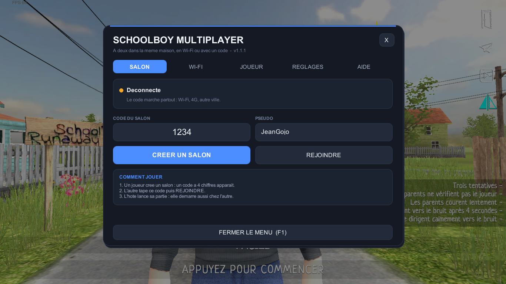
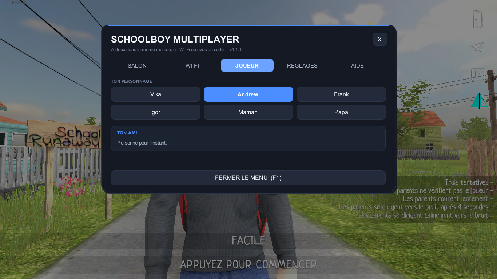
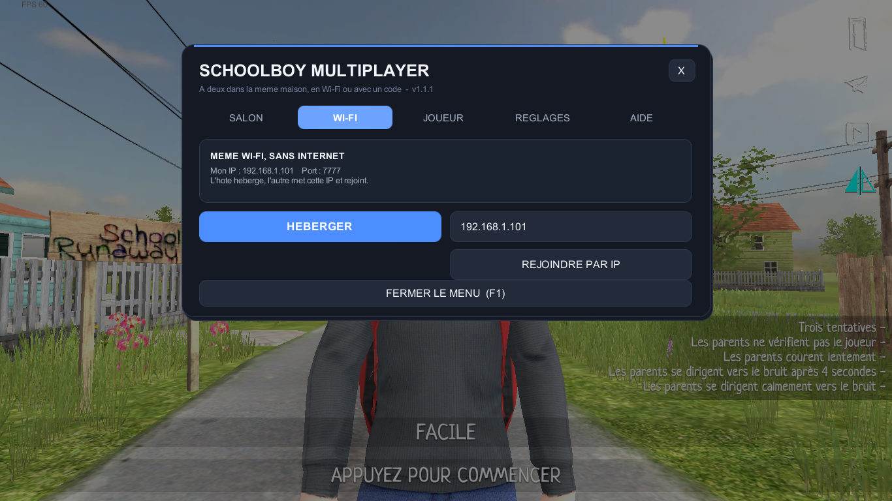

# SchoolBoy Runaway - Multiplayer (PC + Android)

Mod multijoueur pour **SchoolBoy Runaway** : deux joueurs dans la meme maison, en ligne
(code a 4 chiffres via un relais Cloudflare) ou en Wi-Fi local, sur **PC** (BepInEx) et **Android** (MelonLoader).

Version **1.2.2**.

## Ce que fait le mod

- **Avatar anime** de l'autre joueur : vrai modele du jeu (Vika, Andrew, Frank, Igor, Maman, Papa),
  skin au choix, pseudo au-dessus de la tete.
- **Position exacte** : les pieds de l'avatar sont poses sur le sol a partir de la hauteur reelle
  du modele, avec interpolation et extrapolation pour que l'autre joueur soit la ou il est *maintenant*.
- **Demarrage par l'hote uniquement** : l'invite qui essaie de lancer voit « EN ATTENTE DE L'HOTE », et la
  partie demarre chez lui des que l'hote appuie sur JOUER (meme s'il rejoint en cours de partie).
- **Recommencer** relance une manche des deux cotes, sans repasser par le menu.
- **Respawn propre** : apres une arrestation (ou une fin de quete qui renvoie dans la chambre), le niveau
  n'est **pas** recharge : les tiroirs, placards et objets restent dans l'etat ou ils etaient, chez les deux joueurs.
- **Compteur 1/3 ... 3/3**, mode spectateur apres 3 attrapes, bouton RECOMMENCER.
- **Meme partie** : l'hote envoie la disposition complete des objets (position + ouvert/ferme), l'invite
  l'applique (repli par type d'objet si un identifiant manque).
- **Synchronisation en direct** des portes, tiroirs, placards, interrupteurs, objets ramasses et objet tenu en main.
- **Animation de crouch** transmise, **chat** (T sur PC), toasts, capture d'ecran de bug (F2 / menu mobile).
- Interface **mobile et PC identiques** : onglets SALON / WI-FI / JOUEUR / REGLAGES, cartes, HUD avec code du
  salon, ping et compteur, ecran d'attente anime.

| Salon | Joueur | Wi-Fi |
|---|---|---|
|  |  |  |

## Installation

### PC (Windows)

1. Installer **BepInEx 5.4.23.2 (x64)** dans le dossier du jeu.
2. Lancer une fois le jeu pour creer `BepInEx/plugins`.
3. Copier `dist/SchoolBoyMultiplayer.dll` dans `BepInEx/plugins/`.
4. Lancer le jeu : **F1** menu, **T** chat, **F2** capture, **F11** plein ecran.

### Android

L'APK patche (MelonLoader + mod) n'est **pas** distribue ici : il contient le jeu, qui n'appartient pas
a ce depot. Sur une installation deja patchee avec MelonLoader 0.6.5 Android :

1. Copier `dist/SchoolBoyMultiplayerMobile.dll` dans
   `/storage/emulated/0/MelonLoader/com.LinkedSquad.SchoolBoyRunaway/Mods/`
   (le mod le fait tout seul au premier lancement quand il est embarque dans l'APK).
2. Toucher le bouton **MULTI** en haut a gauche. Log du mod : `/sdcard/sbmp_log.txt`.

## Jouer ensemble

### En ligne (code a 4 chiffres, marche sans Wi-Fi commun)
1. L'hote : **SALON** -> **CREER UN SALON** -> un code s'affiche.
2. L'invite : **SALON** -> taper le meme code -> **REJOINDRE**.
3. L'hote lance la partie : elle demarre chez les deux.

### Wi-Fi local (sans Internet)
1. Meme reseau pour les deux appareils.
2. L'hote : **WI-FI** -> **HEBERGER** (affiche son IP et le port 7777).
3. L'invite : taper cette IP -> **REJOINDRE PAR IP**.

## Captures de bug
- **PC** : **F2** -> dossier `Captures/` du jeu.
- **Android** : menu -> **REGLAGES** -> **CAPTURE D'ECRAN** -> `/sdcard/DCIM/SchoolBoyMP/`.

## Technique

- Protocole binaire maison : en-tete 42 octets, etats joueurs a 20 Hz, evenements fiables (attrape, scene,
  redemarrage, ordre de demarrage), disposition du monde en petits paquets, WebSocket (`WsClient`) sur TCP ou TLS.
- Le paquet joueur transporte la hauteur des **pieds** ; le recepteur pose la racine de l'avatar a
  `Y - offsetPieds` (offset mesure sur le clone, re-mesure deux fois car les bounds d'un SkinnedMesh clone sont
  faux au premier frame).
- Deplacement lisse (Lerp exponentiel) + extrapolation sur 250 ms max pour masquer la latence ; le modele de
  l'autre joueur est masque a moins de 85 cm pour ne pas remplir la camera.
- Reconnexion automatique au relais, roles hote/invite collants (`want=host|peer`) decides par le relais
  (premier arrive = hote).
- Le relais Cloudflare (`relay/worker.js`) tient la salle ; `relay/relay-tcp.js` est la version LAN.

## Limitations connues

- Les parents (papa / maman) sont simules sur **chaque** appareil : ils ne sont pas clones d'une machine a
  l'autre. L'hote arbitre les arrestations, donc les deux joueurs peuvent bien se faire attraper.
- Les deux joueurs doivent avoir la **meme version** du mod.
- L'avatar de l'autre joueur est volontairement « fantome » : il ne bloque pas les parents.
- Si le relais tombe, le HUD affiche « Relais : abandon ».

## Credits

Mod par **Buffy**. SchoolBoy Runaway appartient a ses auteurs ; ce depot ne distribue que les DLL compilees
du mod (aucun asset du jeu) et ne publie pas son code source.